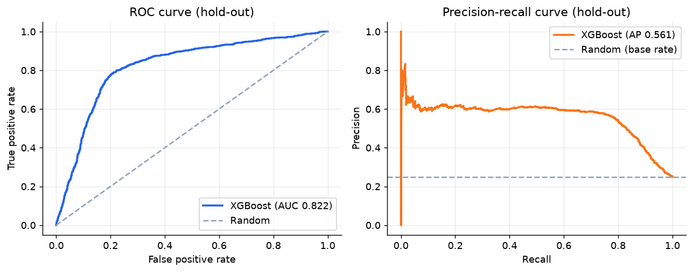
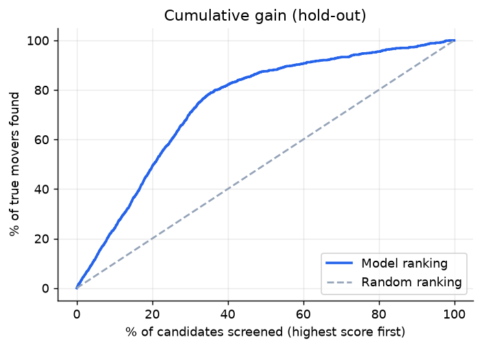
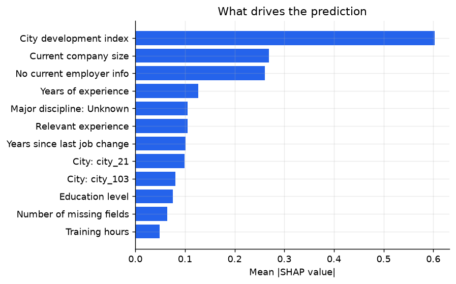

# Smart Recruitment Assistant

Predicts which candidates are likely to be looking for a new job, ranks them by a priority score, and serves the model through a Streamlit app. Built on the Kaggle HR Analytics: Job Change of Data Scientists dataset (19,158 labelled candidates, about 25% of whom are looking to move).

## Problem

HR teams get far more applications than they can follow up on. The goal is to decide which candidates should advance to the next stage of outreach, so recruiters spend their time on the people most likely to be open to a move.

## Results

Scores below are on a stratified 20% hold-out set (3,832 candidates) that was not used for model selection or for choosing the decision threshold.

| Metric | Value |
|---|---|
| ROC-AUC | 0.822 |
| PR-AUC (base rate 0.25) | 0.561 |
| Recall | 76% |
| Precision | 57% |
| F1 | 0.651 |
| Lift in top 10% of ranking | 2.4x |
| Precision at 10 / 50 / 100 | 70% / 64% / 62% |

Screening the top 30% of candidates by score finds roughly 80% of the people who are actually looking.

5-fold cross-validation on the training split:

| Model | ROC-AUC | PR-AUC | F1 |
|---|---|---|---|
| Decision Tree (baseline) | 0.778 | 0.523 | 0.612 |
| Logistic Regression | 0.792 | 0.533 | 0.618 |
| Random Forest | 0.800 | 0.545 | 0.631 |
| XGBoost (selected) | 0.800 | 0.546 | 0.636 |
| LightGBM | 0.800 | 0.543 | 0.636 |

The tree ensembles are within noise of each other, so XGBoost was picked on cross-validated PR-AUC. Everything lands around 0.80 AUC, which suggests the dataset itself limits performance more than the choice of model does.



 

The main drivers according to SHAP are city development index, current company size, whether employer info is missing, and years of experience. Candidates with no employer info are much more likely to be job hunting.

## Streamlit app

```bash
streamlit run app/streamlit_app.py
```

- **Overview**: headline metrics and a short description of the method.
- **Score a candidate**: enter a profile and get a probability, a recommendation, and a SHAP chart showing what pushed the score up or down.
- **Batch screening**: score the demo pool or an uploaded CSV, adjust the threshold, and download the ranked list.
- **Model insights**: model comparison, ROC/PR curves, confusion matrix, precision at k, feature importance and limitations.

## Method

- Cleaning and features are in `src/jobchange/features.py`: `>20`, `<1` and `never` are converted to numbers, education and company size are ordinal-encoded, and I add an `is_unemployed` flag (both company fields missing), a missing-field count and log training hours. Remaining categoricals are one-hot encoded, with rare cities grouped.
- Imputation and encoding sit inside an sklearn `Pipeline`, so they are fitted on training folds only.
- Class imbalance is handled with class weights (`scale_pos_weight` for the boosters) instead of resampling.
- Five models are compared with stratified 5-fold CV and the best one is chosen on PR-AUC.
- The decision threshold maximises F1 on out-of-fold predictions and is applied once to the hold-out set.
- `gender` is not used as a feature.

## Project structure

```
app/streamlit_app.py          Streamlit app
src/jobchange/
    config.py                 paths and constants
    features.py               cleaning and preprocessing pipeline
    train.py                  model comparison, evaluation, saving artefacts
    predict.py                scoring and SHAP explanations
    reporting.py              figures
notebooks/
    01_baseline_decision_tree.ipynb
    02_eda.ipynb
data/raw/                     Kaggle CSVs
models/                       trained model, metrics, feature importance
reports/                      figures and scored candidates
tests/                        pytest suite
```

## Running it

```bash
python -m venv .venv
.venv\Scripts\activate            # macOS/Linux: source .venv/bin/activate
pip install -r requirements.txt

set PYTHONPATH=src                # macOS/Linux: export PYTHONPATH=src
python -m jobchange.train         # about 30 s, rewrites models/ and reports/
pytest
streamlit run app/streamlit_app.py
```

The trained model is in the repo, so the app also starts straight after installing the requirements.

## Limitations

- The score says similar past candidates were job hunting. It does not say this person will accept an offer.
- Other features such as city can still act as proxies for protected attributes, so this would need an audit before real use.
- It is meant to prioritise outreach, not to reject anyone automatically.
- The data is a single 2020 snapshot from one training programme.

## Possible next steps

- Probability calibration and a fairness check across city tiers
- Hyperparameter search
- A small API and Docker image
- Deployment on Streamlit Community Cloud

## Data

[HR Analytics: Job Change of Data Scientists](https://www.kaggle.com/datasets/arashnic/hr-analytics-job-change-of-data-scientists) on Kaggle.
